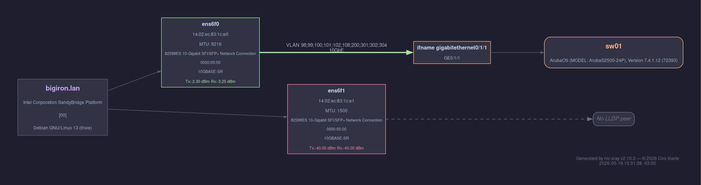
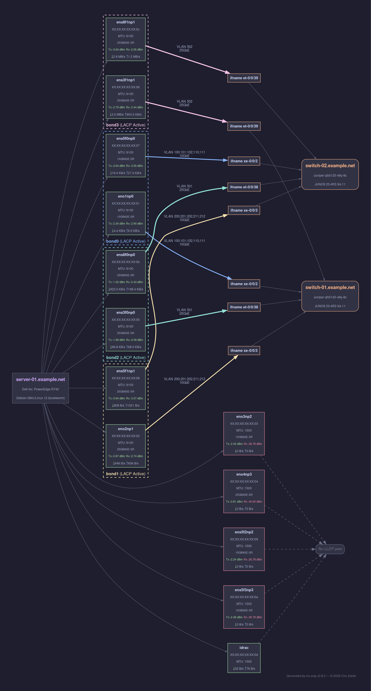
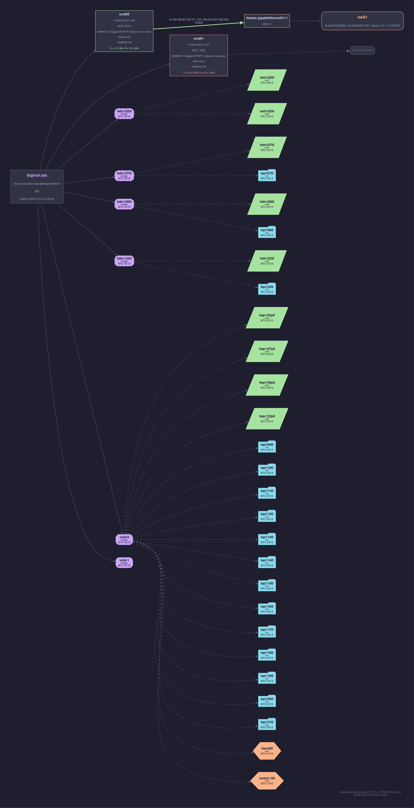

# nic-xray

Detailed physical network interface diagnostics for Linux.

[](https://github.com/ciroiriarte/nic-xray/releases)
[](LICENSE)

## Table of Contents

- [Description](#-description)
- [Features](#-features)
- [Requirements](#%EF%B8%8F-requirements)
- [Apstra Configlet API Snippets](#-apstra-configlet-api-snippets)
- [Installation](#-installation)
- [Usage](#-usage)
- [Output Examples](#-output-examples)
- [NIC Health Checks (nic-health.sh)](#-nic-health-checks-nic-healthsh)
- [Fleet Sweeps (nic-sweep.sh)](#%EF%B8%8F-fleet-sweeps-nic-sweepsh)
- [Fleet Reports (nic-report.py)](#-fleet-reports-nic-reportpy)
- [License](#-license)
- [Contributing](#-contributing)
- [Authors](#%EF%B8%8F-authors)

## 📝 Description

`nic-xray.sh` is a diagnostic script that provides a detailed overview of all **physical network interfaces** on a Linux system. It displays:

- PCI slot
- Driver name
- Firmware version
- Interface name
- MAC address
- MTU
- Link status (with color)
- Negotiated speed and duplex (color-coded by speed tier)
- Bond membership (with color)
- LLDP peer information (switch, port, and port description)
- Optionally: LACP status, VLAN tagging, bond MAC address
- SFP/QSFP optical transceiver diagnostics: Tx/Rx power levels, health status (with `--optics`)
- Physical topology: NUMA node, PCI slot, NIC vendor/model (with `--physical`)
- Virtual/logical interfaces: VLANs, bridges, tap/tun, VXLAN, GRE, WireGuard, ZeroTier, OvS (with `--virtual`)
- Bond MTU consistency checking: detects mismatches between members and masters
- Real-time traffic metrics: throughput, packets/s, drops, errors, FIFO errors (with `--metrics`)
- MTU color coding: yellow for FRAG risk (effective <1500B), red for DROP risk (effective <576B)

Supports multiple output formats: **table** (default, with dynamic column widths), **CSV**, **JSON**, and **network topology diagrams** (DOT/SVG/PNG).

Originally developed for OpenStack node deployments, it is suitable for any Linux environment.

> 🩺 **Companion:** [`nic-health.sh`](#-nic-health-checks-nic-healthsh) evaluates NIC hardware and data-path health (PCIe, AER, temperature, devlink, ConnectX counters, optional vendor-tool deep mode) and returns a Nagios-compatible verdict.
>
> 🛰️ **Fleet:** [`nic-sweep.sh`](#%EF%B8%8F-fleet-sweeps-nic-sweepsh) runs nic-health (and nic-xray) on every host of an inventory over SSH and writes one comparable sweep per site; [`nic-report.py`](#-fleet-reports-nic-reportpy) turns sweeps into single- or multi-site reports.

## 🔍 Features

| Category | Feature | Details |
|----------|---------|---------|
| **Hardware** | PCI slot | Bus address for each physical NIC |
| | Driver & firmware | Kernel driver name and firmware version |
| | Interface name | Predictable network device name |
| | MAC address | Hardware address |
| | MTU | Maximum transmission unit |
| **Link** | Status | Up/down with color coding |
| | Speed & duplex | Negotiated link speed, color-coded by tier |
| **Bonding** | Bond membership | Parent bond device |
| | Bond MAC (`--bmac`) | Bridge MAC address of the bond |
| | LACP status (`--lacp`) | Aggregator ID and LACP partner MAC |
| | MTU consistency | Checks member-to-master and member-to-member MTU mismatches |
| **Switching** | LLDP peer | Connected switch name, port, and port description |
| | Cisco ACI support | Automatic detection of ACI fabric switches via vendor TLVs |
| | VLAN tagging (`--vlan`) | Tagged VLANs with PVID identification |
| **Optics** (`--optics`) | SFP/QSFP type | Transceiver module identification |
| | Tx/Rx power | Optical signal levels in dBm |
| | Health status | OK / WARN / ALARM based on DOM thresholds |
| | Multi-lane support | Per-channel diagnostics for QSFP+/QSFP28 |
| | Lane variance | Flags outlier channels with >2 dB deviation |
| **Physical** (`--physical`) | NUMA node | CPU/memory affinity for each NIC |
| | PCI slot | Shared PCI slot groups multi-port NICs |
| | NIC vendor/model | Hardware identification via `lspci` |
| **Virtual** (`--virtual`) | Type | Virtual interface type (VLAN, bridge, tap/tun, VXLAN, GRE, WireGuard, ZeroTier, OvS) |
| | Parent | Logical parent interface (tree-indented with └─ prefix) |
| | Encap | Encapsulation overhead in bytes |
| | W (Warning) | MTU warning: ! (yellow FRAG <1500B), ✗ (red DROP <576B effective) |
| **Metrics** (`--metrics`) | Throughput | Real-time Rx/Tx bitrate (bps/Kbps/Mbps/Gbps) |
| | Packets/s | Rx/Tx packet rates |
| | Drops & errors | Rx/Tx drops, errors, and FIFO errors |
| **Output** | Table | Dynamic column widths, optional separators |
| | CSV | Machine-readable, configurable delimiter |
| | JSON | Structured output with nested objects |
| | DOT / SVG / PNG | Network topology diagrams (Catppuccin Mocha theme) |
| **Filtering** | Link filter | Show only up or down interfaces |
| | Bond grouping | Sort and group rows by bond membership |
| | Physical sorting | Sort by NUMA → PCI slot → interface (with `--physical`) |
| | Diagram clustering | `--cluster bond` (default) or `--cluster nic` for DOT |
| | Color control | Auto-detect TTY, `--no-color` override |

## ⚙️ Requirements

- Must be run as **root** (`nic-xray.sh` and `nic-health.sh`, on each node)
- Fleet tools (`nic-sweep.sh`, `nic-report.py`, on the operator or jump host, as an unprivileged user): `jq`, an SSH client and Python 3.9+; WeasyPrint optional, for PDF reports. Details in [Fleet Sweeps](#%EF%B8%8F-fleet-sweeps-nic-sweepsh) and [Fleet Reports](#-fleet-reports-nic-reportpy)
- Required tools:
  - `ethtool`
  - `lldpctl`
  - `ip`, `awk`, `grep`, `cat`, `readlink`
- Optional tools:
  - `graphviz` (`dot` command) — required for `--output svg` and `--output png`; not needed for `--output dot`
  - `dmidecode` — used by `--physical` for physical slot designations (e.g., "PCIe Slot 3"); falls back to bus address if absent
  - `lspci` (from `pciutils`) — used by `--physical` for NIC vendor/model names; falls back to raw PCI IDs if absent
- Switch configuration:
  - Switch should advertise LLDP messages
  - **Cisco** — VLAN information is not advertised by default. Enable it with:
    ```
    lldp tlv-select vlan-name
    ```
  - **Juniper** — LLDP VLAN advertisement behaviour depends on platform:
    - **EX series** — By default, Junos LLDP PDUs carry at most **5 VLAN Name TLVs** per
      interface regardless of how many VLANs are configured. Enable full VLAN advertisement
      with:
      ```
      set protocols lldp interface all transmit-max-vlan-name-tlv
      ```
      With standard MTU (1500 B) this allows up to 68 VLANs; with jumbo frames (9192 B) up
      to 523 VLANs. Reference:
      [Juniper — Configuring the Maximum Number of VLAN Name TLVs to Transmit](https://www.juniper.net/documentation/us/en/software/junos/multicast-l2/topics/task/layer-2-services-lldp-transmit-max-vlan-name-tlv.html)

      > **Apstra / IP Fabric managed fabrics (EX):** Deploy the above as a configlet.
      > See [Apstra API snippets](#-apstra-configlet-api-snippets) below.

    - **QFX series** — Uses a different option name than EX. On QFX (confirmed on
      QFX5120 with Junos 23.4R2), use:
      ```
      set protocols lldp interface all transmit-max-vlan-tlv
      ```
      > **Apstra / IP Fabric managed fabrics (QFX):** Deploy the above as a configlet.
      > See [Apstra API snippets](#-apstra-configlet-api-snippets) below.

## 🔌 Apstra Configlet API Snippets

For Juniper Apstra (IP Fabric) managed fabrics, the LLDP VLAN fix can be deployed
as a configlet via the Apstra REST API.

### 1. Authenticate

```bash
TOKEN=$(curl -sk -X POST https://<apstra-ip>/api/user/login \
  -H "Content-Type: application/json" \
  -d '{"username":"admin","password":"<password>"}' \
  | python3 -c "import sys,json; print(json.load(sys.stdin)['token'])")
```

### 2. Create the configlet in the design catalog

```bash
curl -sk -X POST https://<apstra-ip>/api/design/configlets \
  -H "AuthToken: $TOKEN" \
  -H "Content-Type: application/json" \
  -d '{
    "display_name": "LLDP_transmit-max-vlan-tlv",
    "ref_archs": ["two_stage_l3clos"],
    "generators": [{
      "config_style": "junos",
      "section": "system",
      "template_text": "protocols {\n    lldp {\n        interface all {\n            transmit-max-vlan-tlv;\n        }\n    }\n}",
      "negation_template_text": "",
      "filename": ""
    }]
  }'
```

> **Note:** `transmit-max-vlan-tlv` is the correct option for **QFX** platforms
> (e.g., QFX5120). On **EX** series use `transmit-max-vlan-name-tlv` instead.

### 3. Assign the configlet to a blueprint

Replace `<blueprint-id>` with your blueprint UUID (found in the Apstra URL or via
`GET /api/blueprints`).

```bash
BLUEPRINT_ID="<blueprint-id>"

curl -sk -X POST "https://<apstra-ip>/api/blueprints/${BLUEPRINT_ID}/configlets" \
  -H "AuthToken: $TOKEN" \
  -H "Content-Type: application/json" \
  -d '{
    "label": "LLDP_transmit-max-vlan-tlv",
    "condition": "role in [\"leaf\"]",
    "configlet": {
      "display_name": "LLDP_transmit-max-vlan-tlv",
      "generators": [{
        "config_style": "junos",
        "section": "system",
        "template_text": "protocols {\n    lldp {\n        interface all {\n            transmit-max-vlan-tlv;\n        }\n    }\n}",
        "negation_template_text": "",
        "filename": ""
      }]
    }
  }'
```

### 4. Deploy the blueprint

```bash
# Get current staging version
STAGING=$(curl -sk -H "AuthToken: $TOKEN" \
  "https://<apstra-ip>/api/blueprints/${BLUEPRINT_ID}/diff-status" \
  | python3 -c "import sys,json; print(json.load(sys.stdin)['staging_version'])")

# Deploy
curl -sk -X PUT "https://<apstra-ip>/api/blueprints/${BLUEPRINT_ID}/deploy" \
  -H "AuthToken: $TOKEN" \
  -H "Content-Type: application/json" \
  -d "{\"version\": ${STAGING}, \"description\": \"Enable LLDP full VLAN advertisement\"}"
```

## 📦 Installation

### Package (recommended)

Pre-built packages are available for several distributions via the [OBS repository](https://build.opensuse.org/package/show/home:ciriarte:network-tools/nic-xray), built from one source package:

| Package | Install on | Contents |
|---|---|---|
| `nic-xray` | 🖥️ every node | `nic-xray` and `nic-health`, their man pages and bash completions |
| `nic-xray-fleet` | 🛰️ the operator or jump host | `nic-sweep` and `nic-report`, their man pages and bash completions, and the rule catalog `/usr/share/nic-xray/nic-report-rules.json` |

`nic-xray-fleet` adds fleet collection over SSH and offline reports; it requires `nic-xray` of the same version, `jq`, an SSH client and Python 3.9+ (`python311` on openSUSE Leap 15.6, pulled in automatically), and suggests WeasyPrint (`python3-weasyprint`) for PDF reports. Fleet nodes need only `nic-xray`.

<details>
<summary><b>Debian 13</b></summary>

```bash
echo 'deb http://download.opensuse.org/repositories/home:/ciriarte:/network-tools/Debian_13/ /' | sudo tee /etc/apt/sources.list.d/home:ciriarte:network-tools.list
curl -fsSL https://download.opensuse.org/repositories/home:/ciriarte:/network-tools/Debian_13/Release.key | gpg --dearmor | sudo tee /etc/apt/trusted.gpg.d/home_ciriarte_network-tools.gpg > /dev/null
sudo apt update
sudo apt install nic-xray          # every node
sudo apt install nic-xray-fleet    # operator or jump host
```
</details>

<details>
<summary><b>Ubuntu 24.04</b></summary>

```bash
echo 'deb http://download.opensuse.org/repositories/home:/ciriarte:/network-tools/Ubuntu_24.04/ /' | sudo tee /etc/apt/sources.list.d/home:ciriarte:network-tools.list
curl -fsSL https://download.opensuse.org/repositories/home:/ciriarte:/network-tools/Ubuntu_24.04/Release.key | gpg --dearmor | sudo tee /etc/apt/trusted.gpg.d/home_ciriarte_network-tools.gpg > /dev/null
sudo apt update
sudo apt install nic-xray          # every node
sudo apt install nic-xray-fleet    # operator or jump host
```
</details>

<details>
<summary><b>Ubuntu 22.04</b></summary>

```bash
echo 'deb http://download.opensuse.org/repositories/home:/ciriarte:/network-tools/Ubuntu_22.04/ /' | sudo tee /etc/apt/sources.list.d/home:ciriarte:network-tools.list
curl -fsSL https://download.opensuse.org/repositories/home:/ciriarte:/network-tools/Ubuntu_22.04/Release.key | gpg --dearmor | sudo tee /etc/apt/trusted.gpg.d/home_ciriarte_network-tools.gpg > /dev/null
sudo apt update
sudo apt install nic-xray          # every node
sudo apt install nic-xray-fleet    # operator or jump host
```
</details>

<details>
<summary><b>openSUSE Tumbleweed</b></summary>

```bash
zypper addrepo https://download.opensuse.org/repositories/home:/ciriarte:/network-tools/openSUSE_Tumbleweed/home:ciriarte:network-tools.repo
zypper refresh
zypper install nic-xray          # every node
zypper install nic-xray-fleet    # operator or jump host
```
</details>

<details>
<summary><b>openSUSE Slowroll</b></summary>

```bash
zypper addrepo https://download.opensuse.org/repositories/home:/ciriarte:/network-tools/openSUSE_Slowroll/home:ciriarte:network-tools.repo
zypper refresh
zypper install nic-xray          # every node
zypper install nic-xray-fleet    # operator or jump host
```
</details>

<details>
<summary><b>openSUSE Leap 15.6</b></summary>

```bash
zypper addrepo https://download.opensuse.org/repositories/home:/ciriarte:/network-tools/openSUSE_Leap_15.6/home:ciriarte:network-tools.repo
zypper refresh
zypper install nic-xray          # every node
zypper install nic-xray-fleet    # operator or jump host
```
</details>

<details>
<summary><b>Rocky Linux 9</b></summary>

```bash
cd /etc/yum.repos.d/
wget https://download.opensuse.org/repositories/home:/ciriarte:/network-tools/Rocky_9/home:ciriarte:network-tools.repo
dnf install nic-xray          # every node
dnf install nic-xray-fleet    # operator or jump host
```
</details>

<details>
<summary><b>Rocky Linux 10</b></summary>

```bash
cd /etc/yum.repos.d/
wget https://download.opensuse.org/repositories/home:/ciriarte:/network-tools/Rocky_10/home:ciriarte:network-tools.repo
dnf install nic-xray          # every node
dnf install nic-xray-fleet    # operator or jump host
```
</details>

### Manual

#### Script

Copy to `/usr/local/sbin` for easy access:

```bash
sudo cp nic-xray.sh /usr/local/sbin/
sudo chmod +x /usr/local/sbin/nic-xray.sh
# Companion health checks (optional)
sudo cp nic-health.sh /usr/local/sbin/
sudo chmod +x /usr/local/sbin/nic-health.sh
# Fleet sweeps over SSH (optional, operator host only)
sudo cp nic-sweep.sh /usr/local/bin/
sudo chmod +x /usr/local/bin/nic-sweep.sh
# Reports from sweeps (optional, operator host only; Python 3.9+, WeasyPrint for PDF)
sudo cp nic-report.py /usr/local/bin/
sudo chmod +x /usr/local/bin/nic-report.py
sudo make install-rules              # diagnosis rule catalog → /usr/local/share/nic-xray/
```

#### Man page

A man page is available under `man/man8/` for detailed reference (section 8: system administration commands).

**Preview locally** (no installation required):

```bash
man -l man/man8/nic-xray.8
man -l man/man8/nic-health.8
man -l man/man8/nic-sweep.8
man -l man/man8/nic-report.8
```

**Install system-wide:**

```bash
sudo make install-man
```

`make install-man` installs all four pages. After installation, use `man nic-xray`, `man nic-health`, `man nic-sweep` or `man nic-report`.

**Uninstall:**

```bash
sudo make uninstall-man
```

#### Bash completion

A bash completion script (`completions/nic-xray.bash`) completes every option and the values of options that take a fixed set of values.

**📋 Requirements:** the `bash-completion` package (it provides `_init_completion` and `_filedir`). It is installed by default on most desktop distributions, but often missing on minimal server installs:

| Distribution | Package install |
|---|---|
| Debian / Ubuntu / Proxmox | `sudo apt install bash-completion` |
| RHEL / Rocky / Alma / Fedora | `sudo dnf install bash-completion` |
| openSUSE / SLES | `sudo zypper install bash-completion` |

**Source in current session:**

```bash
source completions/nic-xray.bash
source completions/nic-health.bash
source completions/nic-sweep.bash
source completions/nic-report.bash
```

**Install system-wide** (into `/etc/bash_completion.d/`, loaded by every new interactive shell):

```bash
sudo make install-completion
```

The OBS packages install it automatically.

**Verify it is active:**

```bash
$ complete -p nic-xray.sh
complete -F _nic_xray nic-xray.sh
```

**Uninstall:**

```bash
sudo make uninstall-completion
```

**🔤 What gets completed**

| You type | `<TAB>` offers |
|---|---|
| `nic-xray.sh <TAB>` or `nic-xray.sh -<TAB>` | All short and long options |
| `nic-xray.sh --<TAB>` | All long options |
| `--output <TAB>` / `--output=<TAB>` | `table` `csv` `json` `dot` `svg` `png` |
| `--filter-link <TAB>` / `--filter-link=<TAB>` | `up` `down` |
| `--cluster <TAB>` / `--cluster=<TAB>` | `bond` `nic` |
| `--diagram-out <TAB>` / `--diagram-out=<TAB>` | Files and directories |
| `--metrics=` / `--watch=` / `--separator=` | Nothing (type the seconds or separator yourself) |

**🖥️ Examples** (captured output; `⇥` = TAB key):

```text
$ nic-xray.sh --⇥
--all          --diagram-out  --help         --no-color     --physical     --virtual
--bmac         --filter-link  --lacp         --optics       --separator    --vlan
--cluster      --group-bond   --metrics      --output       --version      --watch

$ nic-xray.sh --ph⇥
$ nic-xray.sh --physical

$ nic-xray.sh --output ⇥
csv    dot    json   png    svg    table

$ nic-xray.sh --output=j⇥
$ nic-xray.sh --output=json

$ nic-xray.sh --filter-link ⇥
down  up

$ nic-xray.sh --cluster ⇥
bond  nic

$ nic-xray.sh --output svg --diagram-out topo⇥
topology.png  topology.svg
```

> ⚠️ **Optional values must be attached.** `--metrics`, `--watch` and `--separator` take an *optional* value, which must be written as `--metrics=5`, `-m5`, `--separator='|'` or `-s'|'`. A space-separated value (`--metrics 5`) is **not** read as the interval; it is treated as a separate, ignored argument. For that reason, after `--metrics ⇥` completion offers the option list again rather than a value.

#### lldpd service

Ensure lldpd is running to retrieve LLDP information:

```bash
sudo systemctl enable --now lldpd
```

## 🚀 Usage

### Basic

```bash
sudo nic-xray.sh              # Default view
sudo nic-xray.sh --all        # All optional columns at once
sudo nic-xray.sh -h           # Display help
sudo nic-xray.sh -v           # Display version
```

### Optional columns

```bash
sudo nic-xray.sh --lacp       # Show LACP peer information
sudo nic-xray.sh --vlan       # Show VLAN information
sudo nic-xray.sh --bmac       # Show bond MAC address
sudo nic-xray.sh --optics     # Show SFP/QSFP transceiver diagnostics
sudo nic-xray.sh --physical   # Show NUMA node, PCI slot, NIC vendor/model
sudo nic-xray.sh --virtual    # Show virtual/logical interfaces (VLANs, bridges, tap/tun, VXLAN, etc.)
```

### Traffic metrics

```bash
sudo nic-xray.sh --metrics             # Sample metrics over 30s (default)
sudo nic-xray.sh --metrics=5           # Sample metrics over 5s
sudo nic-xray.sh --metrics --output csv   # Metrics as raw numeric CSV columns
sudo nic-xray.sh --metrics --output json  # Metrics as nested JSON object
```

### Filtering and sorting

```bash
sudo nic-xray.sh --filter-link up      # Only interfaces with link up
sudo nic-xray.sh --filter-link down    # Only interfaces with link down
sudo nic-xray.sh --group-bond          # Group rows by bond
sudo nic-xray.sh --group-bond --all -s # Combined example
```

### Output formats

```bash
sudo nic-xray.sh --output csv                     # CSV output
sudo nic-xray.sh --output csv --separator='|'      # Pipe-delimited CSV
sudo nic-xray.sh --output csv --separator=$'\t'    # Tab-separated CSV
sudo nic-xray.sh --output json                     # JSON output
sudo nic-xray.sh --all --output json               # All columns as JSON
```

### Topology diagrams

```bash
sudo nic-xray.sh --output dot > topology.dot                             # DOT source
sudo nic-xray.sh --output svg                                            # SVG diagram
sudo nic-xray.sh --output png --diagram-out /tmp/network.png             # PNG with custom path
sudo nic-xray.sh --cluster nic --output svg                              # Physical layout (NUMA/slot clusters)
sudo nic-xray.sh --virtual --output dot > topology-virtual.dot           # Virtual iface topology DOT
sudo nic-xray.sh --virtual --output png --diagram-out /tmp/virtual.png   # Virtual iface topology PNG
```

### Formatting

```bash
sudo nic-xray.sh -s                # Table with │ column separators
sudo nic-xray.sh --separator='|'   # Table with custom separator
sudo nic-xray.sh --no-color        # Disable color output
```

## 📸 Output Examples

> MAC addresses and hostnames below are obfuscated. Full sample files are available in [`samples/`](samples/).

### Default table

```
$ sudo nic-xray.sh
Device         Driver      Firmware                 Interface   MAC Address         MTU    Link   Speed/Duplex       Parent Bond   Switch Name             Port Name          Port Descr
------------------------------------------------------------------------------------------------------------------------------------------------------------------------------------------
0000:19:00.0   i40e        9.50 0x8000f25e 23.0.8   eno1np0     XX:XX:XX:XX:XX:01   9100   up     10000Mb/s (Full)   bond0         switch-01.example.net   ifname xe-0/0/2    xe-0/0/2
0000:19:00.1   i40e        9.50 0x8000f25e 23.0.8   eno2np1     XX:XX:XX:XX:XX:02   9100   up     10000Mb/s (Full)   bond1         switch-01.example.net   ifname xe-0/0/3    xe-0/0/3
0000:19:00.2   i40e        9.50 0x8000f25e 23.0.8   eno3np2     XX:XX:XX:XX:XX:03   1500   down   N/A (N/A)          None                                                     N/A
0000:19:00.3   i40e        9.50 0x8000f25e 23.0.8   eno4np3     XX:XX:XX:XX:XX:04   1500   down   N/A (N/A)          None                                                     N/A
0000:5e:00.0   i40e        9.50 0x8000f251 23.0.8   ens3f0np0   XX:XX:XX:XX:XX:05   9100   up     25000Mb/s (Full)   bond2         switch-01.example.net   ifname et-0/0/38   et-0/0/38
0000:5e:00.1   i40e        9.50 0x8000f251 23.0.8   ens3f1np1   XX:XX:XX:XX:XX:06   9100   up     25000Mb/s (Full)   bond3         switch-01.example.net   ifname et-0/0/39   et-0/0/39
0000:86:00.0   i40e        9.50 0x8000f25d 23.0.8   ens5f0np0   XX:XX:XX:XX:XX:07   9100   up     10000Mb/s (Full)   bond0         switch-02.example.net   ifname xe-0/0/2    xe-0/0/2
0000:86:00.1   i40e        9.50 0x8000f25d 23.0.8   ens5f1np1   XX:XX:XX:XX:XX:08   9100   up     10000Mb/s (Full)   bond1         switch-02.example.net   ifname xe-0/0/3    xe-0/0/3
0000:86:00.2   i40e        9.50 0x8000f25d 23.0.8   ens5f2np2   XX:XX:XX:XX:XX:09   1500   down   N/A (N/A)          None                                                     N/A
0000:86:00.3   i40e        9.50 0x8000f25d 23.0.8   ens5f3np3   XX:XX:XX:XX:XX:0a   1500   down   N/A (N/A)          None                                                     N/A
0000:d8:00.0   i40e        9.50 0x8000f251 23.0.8   ens8f0np0   XX:XX:XX:XX:XX:0b   9100   up     25000Mb/s (Full)   bond2         switch-02.example.net   ifname et-0/0/38   et-0/0/38
0000:d8:00.1   i40e        9.50 0x8000f251 23.0.8   ens8f1np1   XX:XX:XX:XX:XX:0c   9100   up     25000Mb/s (Full)   bond3         switch-02.example.net   ifname et-0/0/39   et-0/0/39
1-14.3:1.0     cdc_ether   CDC Ethernet Device      idrac       XX:XX:XX:XX:XX:0d   1500   up     425Mb/s (Half)     None                                                     N/A
```

### All columns with separators

```
$ sudo nic-xray.sh --all -s
NUMA │ PCI Slot    │ NIC Vendor        │ NIC Model                                  │ Device       │ Driver    │ Firmware               │ Interface │ MAC Address       │ MTU  │ Link │ Speed/Duplex     │ Parent Bond │ Bond MAC          │ LACP Status                    │ VLAN                │ SFP Type   │ Optics Tx │ Optics Rx    │ Switch Name           │ Port Name        │ Port Descr
---------------------------------------------------------------------------------------------------------------------------------------------------------------------------------------------------------------------------------------------------------------------------------------------------------------------------------------------------------------------------------------------------
0    │ Embedded    │ Intel Corporation │ Ethernet Controller X710 for 10GbE SFP+    │ 0000:19:00.0 │ i40e      │ 9.50 0x8000f25e 23.0.8 │ eno1np0   │ XX:XX:XX:XX:XX:01 │ 9100 │ up   │ 10000Mb/s (Full) │ bond0       │ XX:XX:XX:XX:XX:01 │ AggID:1 Peer:AA:BB:CC:DD:EE:01 │ 100;101;102;110;111 │ 10GBASE-SR │ -2.38 OK  │ -2.98 OK     │ switch-01.example.net │ ifname xe-0/0/2  │ xe-0/0/2
     │             │                   │                                            │ 0000:19:00.1 │ i40e      │ 9.50 0x8000f25e 23.0.8 │ eno2np1   │ XX:XX:XX:XX:XX:02 │ 9100 │ up   │ 10000Mb/s (Full) │ bond1       │ XX:XX:XX:XX:XX:02 │ AggID:1 Peer:AA:BB:CC:DD:EE:02 │ 200;201;202;211;212 │ 25GBASE-SR │ -1.09 OK  │ -2.84 OK     │ switch-01.example.net │ ifname xe-0/0/3  │ xe-0/0/3
     │             │                   │                                            │ 0000:19:00.2 │ i40e      │ 9.50 0x8000f25e 23.0.8 │ eno3np2   │ XX:XX:XX:XX:XX:03 │ 1500 │ down │ N/A (N/A)        │ None        │ N/A               │ N/A                            │ N/A                 │ 10GBASE-SR │ -2.45 OK  │ -26.78 ALARM │                       │                  │ N/A
...
```

### Filtering — link down only

```
$ sudo nic-xray.sh --filter-link down
Device         Driver   Firmware                 Interface   MAC Address         MTU    Link   Speed/Duplex   Parent Bond   Switch Name   Port Name   Port Descr
----------------------------------------------------------------------------------------------------------------------------------------------------------------
0000:19:00.2   i40e     9.50 0x8000f25e 23.0.8   eno3np2     XX:XX:XX:XX:XX:03   1500   down   N/A (N/A)      None                                    N/A
0000:19:00.3   i40e     9.50 0x8000f25e 23.0.8   eno4np3     XX:XX:XX:XX:XX:04   1500   down   N/A (N/A)      None                                    N/A
0000:86:00.2   i40e     9.50 0x8000f25d 23.0.8   ens5f2np2   XX:XX:XX:XX:XX:09   1500   down   N/A (N/A)      None                                    N/A
0000:86:00.3   i40e     9.50 0x8000f25d 23.0.8   ens5f3np3   XX:XX:XX:XX:XX:0a   1500   down   N/A (N/A)      None                                    N/A
```

### Physical topology

```
$ sudo nic-xray.sh --physical
NUMA   PCI Slot      NIC Vendor          NIC Model                                    Device         Driver      Firmware                 Interface   MAC Address         MTU    Link   Speed/Duplex       Parent Bond   Switch Name             Port Name          Port Descr
------------------------------------------------------------------------------------------------------------------------------------------------------------------------------------------------------------------------------------------------------------------------------
0      Embedded      Intel Corporation   Ethernet Controller X710 for 10GbE SFP+      0000:19:00.0   i40e        9.50 0x8000f25e 23.0.8   eno1np0     XX:XX:XX:XX:XX:01   9100   up     10000Mb/s (Full)   bond0         switch-01.example.net   ifname xe-0/0/2    xe-0/0/2
                                                                                      0000:19:00.1   i40e        9.50 0x8000f25e 23.0.8   eno2np1     XX:XX:XX:XX:XX:02   9100   up     10000Mb/s (Full)   bond1         switch-01.example.net   ifname xe-0/0/3    xe-0/0/3
                                                                                      0000:19:00.2   i40e        9.50 0x8000f25e 23.0.8   eno3np2     XX:XX:XX:XX:XX:03   1500   down   N/A (N/A)          None                                                     N/A
                                                                                      0000:19:00.3   i40e        9.50 0x8000f25e 23.0.8   eno4np3     XX:XX:XX:XX:XX:04   1500   down   N/A (N/A)          None                                                     N/A
       PCIe Slot 3   Intel Corporation   Ethernet Controller XXV710 for 25GbE SFP28   0000:5e:00.0   i40e        9.50 0x8000f251 23.0.8   ens3f0np0   XX:XX:XX:XX:XX:05   9100   up     25000Mb/s (Full)   bond2         switch-01.example.net   ifname et-0/0/38   et-0/0/38
                                                                                      0000:5e:00.1   i40e        9.50 0x8000f251 23.0.8   ens3f1np1   XX:XX:XX:XX:XX:06   9100   up     25000Mb/s (Full)   bond3         switch-01.example.net   ifname et-0/0/39   et-0/0/39
1      PCIe Slot 5   Intel Corporation   Ethernet Controller X710 for 10GbE SFP+      0000:86:00.0   i40e        9.50 0x8000f25d 23.0.8   ens5f0np0   XX:XX:XX:XX:XX:07   9100   up     10000Mb/s (Full)   bond0         switch-02.example.net   ifname xe-0/0/2    xe-0/0/2
                                                                                      0000:86:00.1   i40e        9.50 0x8000f25d 23.0.8   ens5f1np1   XX:XX:XX:XX:XX:08   9100   up     10000Mb/s (Full)   bond1         switch-02.example.net   ifname xe-0/0/3    xe-0/0/3
                                                                                      0000:86:00.2   i40e        9.50 0x8000f25d 23.0.8   ens5f2np2   XX:XX:XX:XX:XX:09   1500   down   N/A (N/A)          None                                                     N/A
                                                                                      0000:86:00.3   i40e        9.50 0x8000f25d 23.0.8   ens5f3np3   XX:XX:XX:XX:XX:0a   1500   down   N/A (N/A)          None                                                     N/A
       PCIe Slot 8   Intel Corporation   Ethernet Controller XXV710 for 25GbE SFP28   0000:d8:00.0   i40e        9.50 0x8000f251 23.0.8   ens8f0np0   XX:XX:XX:XX:XX:0b   9100   up     25000Mb/s (Full)   bond2         switch-02.example.net   ifname et-0/0/38   et-0/0/38
                                                                                      0000:d8:00.1   i40e        9.50 0x8000f251 23.0.8   ens8f1np1   XX:XX:XX:XX:XX:0c   9100   up     25000Mb/s (Full)   bond3         switch-02.example.net   ifname et-0/0/39   et-0/0/39
N/A    1-14.3:1      Unknown             Unknown                                      1-14.3:1.0     cdc_ether   CDC Ethernet Device      idrac       XX:XX:XX:XX:XX:0d   1500   up     425Mb/s (Half)     None                                                     N/A
```

Shows NUMA node, PCI slot designation (`Embedded` for onboard NICs, `dmidecode` slot name for add-in cards, raw bus address as fallback), NIC vendor, and NIC model. Interfaces sharing a PCI slot belong to the same physical NIC card. Rows are sorted by NUMA → slot → interface, with repeated values suppressed for visual grouping.

### Virtual interfaces

```
$ sudo nic-xray.sh --virtual
Type       Parent      Encap   W   Device         Driver                Firmware               Interface      MAC Address         MTU    Link   Speed/Duplex       Parent Bond   Switch Name   Port Name                     Port Descr
---------------------------------------------------------------------------------------------------------------------------------------------------------------------------------------------------------------------------------------
physical   vmbr0       —           0000:05:00.0   ixgbe                 0x800009e1, 1.3227.0   └─ ens6f0      14:02:ec:83:1c:e0   9216   up     10000Mb/s (Full)   None          sw01          ifname gigabitethernet0/1/1   GE0/1/1
physical   —           —           0000:05:00.1   ixgbe                 0x800009e1, 1.3227.0   ens6f1         14:02:ec:83:1c:e1   1500   down   N/A (N/A)          None                                                      N/A
bridge     —           —           virtual        bridge                N/A                    fwbr102i0      62:f8:2d:7d:ed:bb   9216   up     N/A (N/A)          None                                                      N/A
virtual    fwbr102i0   —           virtual        veth                  N/A                    └─ fwln102i0   62:f8:2d:7d:ed:bb   9216   up     N/A (N/A)          None                                                      N/A
virtual    vmbr0       —           virtual        veth                  N/A                    └─ fwpr102p0   ba:5f:9b:22:04:85   9216   up     N/A (N/A)          None                                                      N/A
tun        fwbr107i0   —           virtual        tun                   N/A                    └─ tap107i0    26:71:7d:d8:ef:3f   9216   down   N/A (N/A)          None                                                      N/A
vlan       vmbr0       4           virtual        802.1Q VLAN Support   N/A                    └─ vlan400     14:02:ec:83:1c:e0   9100   up     N/A (N/A)          None                                                      N/A
bridge     —           —           virtual        bridge                N/A                    vmbr0          14:02:ec:83:1c:e0   9216   up     N/A (N/A)          None                                                      N/A
vlan       vmbr0       4           virtual        802.1Q VLAN Support   N/A                    └─ vmbr0.100   14:02:ec:83:1c:e0   1500   up     N/A (N/A)          None                                                      N/A
...
```

Physical NICs appear with their virtual parent (bridge, OvS, bond) in the `Parent` column; child interfaces are indented with `└─`. The `W` column flags MTU fragmentation risk (`FRAG`) or packet drop risk (`DROP`) for child interfaces with a smaller MTU than their parent.

See also: [`samples/table-virtual.txt`](samples/table-virtual.txt)

### Optics diagnostics

```
$ sudo nic-xray.sh --optics
Device         Driver      Firmware                 Interface   MAC Address         MTU    Link   Speed/Duplex       Parent Bond   SFP Type     Optics Tx   Optics Rx      Switch Name             Port Name          Port Descr
----------------------------------------------------------------------------------------------------------------------------------------------------------------------------------------------------------------------------------
0000:19:00.0   i40e        9.50 0x8000f25e 23.0.8   eno1np0     XX:XX:XX:XX:XX:01   9100   up     10000Mb/s (Full)   bond0         10GBASE-SR   -2.36 OK    -2.97 OK       switch-01.example.net   ifname xe-0/0/2    xe-0/0/2
0000:19:00.1   i40e        9.50 0x8000f25e 23.0.8   eno2np1     XX:XX:XX:XX:XX:02   9100   up     10000Mb/s (Full)   bond1         25GBASE-SR   -1.08 OK    -2.79 OK       switch-01.example.net   ifname xe-0/0/3    xe-0/0/3
0000:19:00.2   i40e        9.50 0x8000f25e 23.0.8   eno3np2     XX:XX:XX:XX:XX:03   1500   down   N/A (N/A)          None          10GBASE-SR   -2.44 OK    -26.78 ALARM                                                  N/A
0000:19:00.3   i40e        9.50 0x8000f25e 23.0.8   eno4np3     XX:XX:XX:XX:XX:04   1500   down   N/A (N/A)          None          25GBASE-SR   -0.94 OK    -40.00 ALARM                                                  N/A
...
1-14.3:1.0     cdc_ether   CDC Ethernet Device      idrac       XX:XX:XX:XX:XX:0d   1500   up     425Mb/s (Half)     None          N/A          N/A N/A     N/A N/A                                                       N/A
```

Health status: **OK** (within normal range), **WARN** (approaching threshold), **ALARM** (beyond threshold or no signal), **N/DOM** (no DOM data), **N/A** (copper/no SFP).

### Traffic metrics table

```
$ sudo nic-xray.sh --all --metrics=6
NUMA   PCI Slot      NIC Vendor          NIC Model                                    Device         Driver      Firmware                 Interface   MAC Address         MTU    Link   Speed/Duplex       Parent Bond   Bond MAC            LACP Status                      VLAN                  SFP Type     Optics Tx   Optics Rx      Throughput                   Packets/s         Drops       Errors      FIFO Errors   Switch Name             Port Name          Port Descr
--------------------------------------------------------------------------------------------------------------------------------------------------------------------------------------------------------------------------------------------------------------------------------------------------------------------------------------------------------------------------------------------------------------------------------------------------------------------------------------
0      Embedded      Intel Corporation   Ethernet Controller X710 for 10GbE SFP+      0000:19:00.0   i40e        9.50 0x8000f25e 23.0.8   eno1np0     XX:XX:XX:XX:XX:01   9100   up     10000Mb/s (Full)   bond0         XX:XX:XX:XX:XX:01   AggID:1 Peer:AA:BB:CC:DD:EE:01   100;101;102;110;111   10GBASE-SR   -2.37 OK    -2.99 OK       Rx:45.0 Kbps Tx:64.7 Kbps     Rx:17 Tx:8        Rx:0 Tx:0   Rx:0 Tx:0   Rx:0 Tx:0     switch-01.example.net   ifname xe-0/0/2    xe-0/0/2
       PCIe Slot 3   Intel Corporation   Ethernet Controller XXV710 for 25GbE SFP28   0000:5e:00.1   i40e        9.50 0x8000f251 23.0.8   ens3f1np1   XX:XX:XX:XX:XX:06   9100   up     25000Mb/s (Full)   bond3         XX:XX:XX:XX:XX:06   AggID:1 Peer:AA:BB:CC:DD:EE:04   502                   25GBASE-SR   -2.79 OK    -2.50 OK       Rx:36.0 Mbps Tx:15.0 Mbps     Rx:1664 Tx:1489   Rx:0 Tx:0   Rx:0 Tx:0   Rx:0 Tx:0     switch-01.example.net   ifname et-0/0/39   et-0/0/39
...

📊 Metrics sampled over 6s
```

### CSV output

```
$ sudo nic-xray.sh --output csv
Device,Driver,Firmware,Interface,MAC Address,MTU,Link,Speed/Duplex,Parent Bond,Switch Name,Port Name,Port Descr
0000:19:00.0,i40e,9.50 0x8000f25e 23.0.8,eno1np0,XX:XX:XX:XX:XX:01,9100,up,10000Mb/s (Full),bond0,switch-01.example.net,ifname xe-0/0/2,xe-0/0/2
0000:19:00.1,i40e,9.50 0x8000f25e 23.0.8,eno2np1,XX:XX:XX:XX:XX:02,9100,up,10000Mb/s (Full),bond1,switch-01.example.net,ifname xe-0/0/3,xe-0/0/3
0000:19:00.2,i40e,9.50 0x8000f25e 23.0.8,eno3np2,XX:XX:XX:XX:XX:03,1500,down,N/A (N/A),None,,,N/A
...
```

### Optics CSV

```
$ sudo nic-xray.sh --optics --output csv
Device,Driver,Firmware,Interface,MAC Address,MTU,Link,Speed/Duplex,Parent Bond,SFP Type,SFP Vendor,Wavelength,Tx Power (dBm),Tx Status,Rx Power (dBm),Rx Status,Lane Count,Switch Name,Port Name,Port Descr
0000:19:00.0,i40e,9.50 0x8000f25e 23.0.8,eno1np0,XX:XX:XX:XX:XX:01,9100,up,10000Mb/s (Full),bond0,10GBASE-SR,DELL EMC,850nm,-2.37,OK,-2.97,OK,1,switch-01.example.net,ifname xe-0/0/2,xe-0/0/2
0000:19:00.2,i40e,9.50 0x8000f25e 23.0.8,eno3np2,XX:XX:XX:XX:XX:03,1500,down,N/A (N/A),None,10GBASE-SR,DELL EMC,850nm,-2.44,OK,-26.78,ALARM,1,,,N/A
...
```

### CSV with metrics

```
$ sudo nic-xray.sh --all --metrics=6 --output csv
NUMA,PCI Slot,NIC Vendor,NIC Model,Device,Driver,Firmware,Interface,MAC Address,MTU,Link,Speed/Duplex,Parent Bond,Bond MAC,LACP Status,VLAN,SFP Type,SFP Vendor,Wavelength,Tx Power (dBm),Tx Status,Rx Power (dBm),Rx Status,Lane Count,Rx Bits/s,Tx Bits/s,Rx Packets/s,Tx Packets/s,Rx Drops,Tx Drops,Rx Errors,Tx Errors,Rx FIFO Errors,Tx FIFO Errors,Sample Duration,Switch Name,Port Name,Port Descr
0,Embedded,Intel Corporation,Ethernet Controller X710 for 10GbE SFP+,0000:19:00.0,i40e,9.50 0x8000f25e 23.0.8,eno1np0,XX:XX:XX:XX:XX:01,9100,up,10000Mb/s (Full),bond0,XX:XX:XX:XX:XX:01,AggID:1 Peer:AA:BB:CC:DD:EE:01,100;101;102;110;111,10GBASE-SR,DELL EMC,850nm,-2.37,OK,-2.97,OK,1,44944,57880,17,7,0,0,0,0,0,0,6,switch-01.example.net,ifname xe-0/0/2,xe-0/0/2
0,PCIe Slot 3,Intel Corporation,Ethernet Controller XXV710 for 25GbE SFP28,0000:5e:00.1,i40e,9.50 0x8000f251 23.0.8,ens3f1np1,XX:XX:XX:XX:XX:06,9100,up,25000Mb/s (Full),bond3,XX:XX:XX:XX:XX:06,AggID:1 Peer:AA:BB:CC:DD:EE:04,502,25GBASE-SR,PRECISION,850nm,-2.79,OK,-2.50,OK,1,36044328,15249888,1664,1489,0,0,0,0,0,0,6,switch-01.example.net,ifname et-0/0/39,et-0/0/39
...
```

### JSON output

```
$ sudo nic-xray.sh --output json --all
[
  {
    "numa_node": "0",
    "pci_slot": "Embedded",
    "nic_vendor": "Intel Corporation",
    "nic_model": "Ethernet Controller X710 for 10GbE SFP+",
    "device": "0000:19:00.0",
    "driver": "i40e",
    "firmware": "9.50 0x8000f25e 23.0.8",
    "interface": "eno1np0",
    "mac_address": "XX:XX:XX:XX:XX:01",
    "mtu": 9100,
    "link": "up",
    "speed_duplex": "10000Mb/s (Full)",
    "parent_bond": "bond0",
    "bond_mac": "XX:XX:XX:XX:XX:01",
    "lacp_status": "AggID:1 Peer:AA:BB:CC:DD:EE:01",
    "vlan": "100;101;102;110;111",
    "optics": {
      "sfp_type": "10GBASE-SR",
      "vendor": "DELL EMC",
      "wavelength": "850nm",
      "tx_power_dbm": -2.38,
      "tx_status": "OK",
      "rx_power_dbm": -2.97,
      "rx_status": "OK",
      "lanes": 1
    },
    "switch_name": "switch-01.example.net",
    "port_name": "ifname xe-0/0/2",
    "port_descr": "xe-0/0/2"
  },
  ...
]
```

### JSON with metrics

```
$ sudo nic-xray.sh --all --metrics=6 --output json
[
  {
    "numa_node": "0",
    "pci_slot": "Embedded",
    "nic_vendor": "Intel Corporation",
    "nic_model": "Ethernet Controller X710 for 10GbE SFP+",
    "device": "0000:19:00.0",
    ...
    "optics": {
      "sfp_type": "10GBASE-SR",
      "vendor": "DELL EMC",
      "wavelength": "850nm",
      "tx_power_dbm": -2.36,
      "tx_status": "OK",
      "rx_power_dbm": -2.97,
      "rx_status": "OK",
      "lanes": 1
    },
    "metrics": {
      "sample_duration_seconds": 6,
      "rx_bits_per_sec": 56784,
      "tx_bits_per_sec": 60880,
      "rx_packets_per_sec": 17,
      "tx_packets_per_sec": 9,
      "rx_drops": 0,
      "tx_drops": 0,
      "rx_errors": 0,
      "tx_errors": 0,
      "rx_fifo_errors": 0,
      "tx_fifo_errors": 0
    },
    "switch_name": "switch-01.example.net",
    "port_name": "ifname xe-0/0/2",
    "port_descr": "xe-0/0/2"
  },
  ...
]
```

### Topology diagram (DOT)

```bash
sudo nic-xray.sh --output dot > topology.dot    # Generate DOT source
sudo nic-xray.sh --output svg                    # Render SVG (requires graphviz)
sudo nic-xray.sh --output png                    # Render PNG (requires graphviz)
```

The diagram shows server NICs grouped by bond (color-coded) by default (`--cluster bond`), connected to switch ports, with MAC addresses and MTU. VLAN information appears near the NIC end of each link and negotiated speed tier near the switch port end. PVID is bold+underlined to distinguish it from tagged VLANs. Edge thickness scales with link speed. When `--optics` is active, each NIC node includes SFP type and Tx/Rx power levels color-coded by health status. Use `--cluster nic` to group by physical topology instead (NUMA → PCI slot → NIC card → ports), with bond membership shown via edge colors.



See also: [`samples/topology.dot`](samples/topology.dot) | [`samples/topology.svg`](samples/topology.svg)

When `--metrics` is active, each NIC node also shows real-time throughput (with `↓`/`↑` arrows). If any drops, errors, or FIFO errors are detected during sampling, they are shown in red.



See also: [`samples/topology-metrics.dot`](samples/topology-metrics.dot) | [`samples/topology-metrics.svg`](samples/topology-metrics.svg)

When `--virtual` is active, the diagram includes all virtual interfaces (bridges, VLANs, TAP/TUN devices, veth pairs) with parent–child edges showing the full network stack.



See also: [`samples/topology-virtual.dot`](samples/topology-virtual.dot) | [`samples/topology-virtual.svg`](samples/topology-virtual.svg)

## 🩺 NIC Health Checks (`nic-health.sh`)

`nic-health.sh` is the companion of `nic-xray.sh`. nic-xray shows **what is installed and how it is cabled**. nic-health answers **whether the NIC hardware and its data path are healthy**. It returns a monitoring-friendly verdict with evidence and a remediation hint for every check.

- 🔒 **Read-only.** It never changes NIC, driver, link or firmware state.
- ⏱️ **Measures, not snapshots.** Counters are read twice, `-I SEC` apart (default 5 s), and only growth inside that window is judged. A counter that resets or disappears during the window is `UNKNOWN`, never `OK`. Bursty link errors can miss a short window, so PHY and frame errors that are high since boot stay `WARN` even when the window saw none. Use `-I 30` or longer when troubleshooting.
- 🧩 **Card-aware.** Ports of the same ASIC are grouped; card-level checks run once.
- 🚦 **Nagios-compatible exit codes:** `0` OK, `1` WARN, `2` CRIT, `3` UNKNOWN (precedence CRIT > WARN > UNKNOWN > OK).

Design and rationale: [`docs/design/nic-health.md`](docs/design/nic-health.md). Full reference: `man -l man/man8/nic-health.8`.

### 🔎 Checks

| Area | Check IDs | Data source |
|---|---|---|
| PCIe link | `generic.pcie.link` | sysfs link speed/width vs. the lower of the card's and its slot's maxima (a narrower slot by design is OK) |
| PCIe errors | `generic.pcie.aer` | sysfs AER counters (fatal/non-fatal → CRIT, correctable → WARN) |
| Temperature | `generic.temperature` | hwmon sensors (critical → CRIT, within 10 °C → WARN) |
| Firmware/driver health | `generic.devlink.health.*` | `devlink health` reporters (device and port) |
| Link stability | `generic.link.state`, `generic.link.flaps`, `generic.link.lookback` | no carrier on a port in use (bond/bridge member, VLAN, SR-IOV VFs, global address; spare ports N/A, WARN if they had link this boot; `ip` missing → UNKNOWN); sysfs `carrier_changes` (in the window); driver link-down messages in the kernel journal over the last `-L` minutes |
| NVIDIA ConnectX (`mlx5_core`) | `mlx5.rx.starvation`, `mlx5.nic.discards`, `mlx5.phy.errors`, `mlx5.frame.errors`, `mlx5.pcie.path`, `mlx5.datapath.faults`, `mlx5.congestion`, `mlx5.pause.storm`, `mlx5.module`, `mlx5.link.phy_down` | `ethtool -S` (aggregate counters) |
| Deep mode (`-l deep`) | `mlx5.deep.troubleshooting`, `mlx5.deep.fec`, `mlx5.deep.ber`, `mlx5.deep.module` | `mlxlink` / `mstlink -d <BDF> -m -c` |

### 🧰 Requirements and optional tools

- **Required:** Bash ≥ 4.4, root, `ethtool`, `getopt` (util-linux), `readlink` (coreutils).
- **Optional:** `lspci` (pciutils, model names), `devlink` and `ip` (iproute2, health reporters and port-in-use addresses), `timeout` (coreutils, required for `-l deep`), `journalctl` (systemd, link-down look-back).
- **Deep mode on ConnectX:** `mstflint` (distribution package, provides `mstlink`) or NVIDIA MFT (`mlxlink`, proprietary, install manually). Both are validated on hardware and give identical verdicts; MFT also reports the PHY `Link Down Counter`. MFT's `install.sh --without-kernel` is enough: `mlxlink -d <BDF>` works without the MFT kernel module (no DKMS build), via the `mft-mlx5` package. Vendor tools are never bundled or downloaded.

Check what is available, without root:

```bash
nic-health.sh --check-tools
```

### 🚀 Usage

```bash
sudo nic-health.sh                         # all physical NICs, 5 s window, problems only
sudo nic-health.sh -a                      # also list OK and N/A rows
sudo nic-health.sh -i ens1f0np0 -I 30      # one interface, 30 s window (troubleshooting)
sudo nic-health.sh -I 0                    # totals since boot, no wait (severity capped at WARN)
sudo nic-health.sh -L 1440                 # link-downs over the last 24 h (default look-back: 60 min)
sudo nic-health.sh -l deep                 # add allowlisted mlxlink/mstlink queries
sudo nic-health.sh -O json > health.json   # for monitoring or later comparison
```

| Option | Description |
|---|---|
| `-i`, `--interface IFACE` | Evaluate only IFACE (repeatable) |
| `-I`, `--interval SEC` | Sampling window, 0–3600 s (default 5, for sweeps and monitoring; 30+ for troubleshooting). `0` = totals since boot |
| `-L`, `--lookback MIN` | Link-down look-back in the kernel journal, 0–1440 min (default 60, current boot only). `0` = off |
| `-O`, `--output FORMAT` | `table` (default), `csv`, `json` |
| `-l`, `--level LEVEL` | `basic` (default, passive) or `deep` (vendor tool queries) |
| `-a`, `--all` | Table: also list OK and N/A rows (CSV/JSON always contain every row) |
| `-n`, `--no-color` | Disable colors (automatic when not a terminal) |
| `-t`, `--check-tools` | List tools, what each enables, and where to get it |
| `-v`, `--version` / `-h`, `--help` | Version / usage |

🧾 **JSON** (`schema_version` 2) adds an optional `metrics` object to each result: the values behind its evidence as typed JSON (counters as `{"total": N, "delta": N}`, optics, BER, FEC, PCIe link, temperatures), so tools need not parse the evidence text. On `generic.link.state` it also records each port's service impact: `in_use` and why (`bond`, `bridge`, `upper`, `sriov_vfs`, `global_address`), its `bond` and `bond_link_failures` (from `/proc/net/bonding`), and `rx_bytes`/`tx_bytes` (whose `delta` shows traffic in the window). Values that are absent are left out, never written as 0. The evidence, the table and CSV are unchanged. Keys per check: `man nic-health` (JSON) or [`docs/design/nic-health.md`](docs/design/nic-health.md) §10.

### 🔬 Deep mode safety

With `-l deep`, each ConnectX physical function gets exactly one query: `timeout -k 2 10 mlxlink -d <BDF> -m -c`, or `mstlink` when MFT is absent. An allowlist gate checks the tool, the exact argument template, the PCI address format and a forbidden-flag list before every call. Eye scans, PRBS, link/FEC changes, counter clears, register access, firmware operations, `mst start` and devlink dumps/recovery are **never** run. `mlxconfig`/`mstconfig` are not used: they cost several seconds of kernel time per device.

### 📸 Output examples

All samples are real captures with hostnames obfuscated (see [`samples/`](samples/)), taken with nic-health 2.11.0; the version in their banners follows each release. Later versions add rows and evidence fields (for example `generic.link.state`, `generic.link.lookback`, and `Raw Physical Errors Per Lane` in `mlx5.deep.ber`).

**Healthy host** (Intel 82599ES):

```
🩺 nic-health.sh 2.14.0  host server-02.example.net  2026-10-20T17:46:28Z  window 5.02s

Hardware
  0000:05:00  Intel Corporation 82599ES 10-Gigabit SFI/SFP+ Network Connection  (ixgbe, fw 0x800009e1, 1.3227.0)
    └─ ens6f0 (up)  ens6f1 (down)

Checks
  ✅ No problems found in 6 checks (-a/--all lists them)

Summary: ✅ 5 OK   ⚠️ 0 WARN   ❌ 0 CRIT   ❔ 0 UNKNOWN   ➖ 1 N/A   → OK (exit 0)
```

**Host with a live fault** (4× ConnectX-6 Lx, 25G AOC links running without FEC; growing uncorrectable symbol errors on four ports):

```
🩺 nic-health.sh 2.14.0  host server-01.example.net  2026-10-20T17:45:47Z  window 5.55s

Hardware
  0000:01:00  Mellanox Technologies MT2894 Family [ConnectX-6 Lx]  (mlx5_core, fw 26.47.1026 (LNV0000000036))
    └─ ens1f0np0 (up)  ens1f1np1 (up)
  0000:41:00  Mellanox Technologies MT2894 Family [ConnectX-6 Lx]  (mlx5_core, fw 26.47.1026 (LNV0000000037))
    └─ ens13f0np0 (up)  ens13f1np1 (up)
  0000:c1:00  Mellanox Technologies MT2894 Family [ConnectX-6 Lx]  (mlx5_core, fw 26.47.1026 (LNV0000000036))
    └─ ens5f0np0 (up)  ens5f1np1 (up)
  0000:e1:00  Mellanox Technologies MT2894 Family [ConnectX-6 Lx]  (mlx5_core, fw 26.47.1026 (LNV0000000036))
    └─ ens4f0np0 (up)  ens4f1np1 (up)

Checks
  SEVERITY  SCOPE  TARGET      CHECK              VALUE                                                       THRESHOLD                        HINT
  CRIT      port   ens1f0np0   mlx5.phy.errors    rx_symbol_err_phy=+94 rx_pcs_symbol_err_phy=+94 per window  >0 CRIT, pre-FEC BER>1e-06 WARN  Active FEC is Off at 25000 Mb/s: links at 25G and above normally rely on RS-FEC to correct routine bit errors; check that FEC matches on both ends. Uncorrectable symbol errors: traffic is being lost; clean/replace the optic or cable, check peer port and FEC mode
  WARN      port   ens1f0np0   mlx5.frame.errors  rx_crc_errors_phy=+94 per window                            >0 WARN                          Frame errors: CRC/fragments/jabbers point to cabling or optics; oversize frames to an MTU mismatch with the peer
  CRIT      port   ens13f1np1  mlx5.phy.errors    rx_symbol_err_phy=+7 rx_pcs_symbol_err_phy=+7 per window    >0 CRIT, pre-FEC BER>1e-06 WARN  Active FEC is Off at 25000 Mb/s: links at 25G and above normally rely on RS-FEC to correct routine bit errors; check that FEC matches on both ends. Uncorrectable symbol errors: traffic is being lost; clean/replace the optic or cable, check peer port and FEC mode
  WARN      port   ens13f1np1  mlx5.frame.errors  rx_crc_errors_phy=+7 per window                             >0 WARN                          Frame errors: CRC/fragments/jabbers point to cabling or optics; oversize frames to an MTU mismatch with the peer
  CRIT      port   ens5f0np0   mlx5.phy.errors    rx_symbol_err_phy=+3 rx_pcs_symbol_err_phy=+3 per window    >0 CRIT, pre-FEC BER>1e-06 WARN  Active FEC is Off at 25000 Mb/s: links at 25G and above normally rely on RS-FEC to correct routine bit errors; check that FEC matches on both ends. Uncorrectable symbol errors: traffic is being lost; clean/replace the optic or cable, check peer port and FEC mode
  WARN      port   ens5f0np0   mlx5.frame.errors  rx_crc_errors_phy=+3 per window                             >0 WARN                          Frame errors: CRC/fragments/jabbers point to cabling or optics; oversize frames to an MTU mismatch with the peer
  CRIT      port   ens4f1np1   mlx5.phy.errors    rx_symbol_err_phy=+2 rx_pcs_symbol_err_phy=+2 per window    >0 CRIT, pre-FEC BER>1e-06 WARN  Active FEC is Off at 25000 Mb/s: links at 25G and above normally rely on RS-FEC to correct routine bit errors; check that FEC matches on both ends. Uncorrectable symbol errors: traffic is being lost; clean/replace the optic or cable, check peer port and FEC mode
  WARN      port   ens4f1np1   mlx5.frame.errors  rx_crc_errors_phy=+2 per window                             >0 WARN                          Frame errors: CRC/fragments/jabbers point to cabling or optics; oversize frames to an MTU mismatch with the peer
  140 OK/N/A rows hidden (-a/--all to show)

Summary: ✅ 140 OK   ⚠️ 4 WARN   ❌ 4 CRIT   ❔ 0 UNKNOWN   ➖ 0 N/A   → CRIT (exit 2)
```

**Deep mode** on the same host (deep rows only): the modules are specified for FEC operation, but every link runs without it, and the effective BER since the last counter clear is above 1E-12 on the erroring ports:

```
  SEVERITY  SCOPE  TARGET      CHECK              VALUE                                                       THRESHOLD                        HINT
  WARN      port   ens1f0np0   mlx5.deep.fec      link: No FEC                                                module FEC = link FEC            Module is specified for operation with FEC but the link runs without it: enable RS-FEC on both ends (NIC and switch port)
  WARN      port   ens1f0np0   mlx5.deep.ber      effective 5E-10 raw 5E-10                                   effective<1E-12                  Average since the last counter clear (71744.6 min) exceeds 1E-12: clean/replace the optic or cable, check FEC; mlx5.phy.errors shows whether errors are still growing
  WARN      port   ens1f1np1   mlx5.deep.fec      link: No FEC                                                module FEC = link FEC            Module is specified for operation with FEC but the link runs without it: enable RS-FEC on both ends (NIC and switch port)
  WARN      port   ens13f0np0  mlx5.deep.fec      link: No FEC                                                module FEC = link FEC            Module is specified for operation with FEC but the link runs without it: enable RS-FEC on both ends (NIC and switch port)
  WARN      port   ens13f1np1  mlx5.deep.fec      link: No FEC                                                module FEC = link FEC            Module is specified for operation with FEC but the link runs without it: enable RS-FEC on both ends (NIC and switch port)
  WARN      port   ens13f1np1  mlx5.deep.ber      effective 8E-11 raw 8E-11                                   effective<1E-12                  Average since the last counter clear (71744.8 min) exceeds 1E-12: clean/replace the optic or cable, check FEC; mlx5.phy.errors shows whether errors are still growing
  WARN      port   ens5f0np0   mlx5.deep.fec      link: No FEC                                                module FEC = link FEC            Module is specified for operation with FEC but the link runs without it: enable RS-FEC on both ends (NIC and switch port)
  WARN      port   ens5f0np0   mlx5.deep.ber      effective 6E-12 raw 6E-12                                   effective<1E-12                  Average since the last counter clear (71744.6 min) exceeds 1E-12: clean/replace the optic or cable, check FEC; mlx5.phy.errors shows whether errors are still growing
  WARN      port   ens5f1np1   mlx5.deep.fec      link: No FEC                                                module FEC = link FEC            Module is specified for operation with FEC but the link runs without it: enable RS-FEC on both ends (NIC and switch port)
  WARN      port   ens4f0np0   mlx5.deep.fec      link: No FEC                                                module FEC = link FEC            Module is specified for operation with FEC but the link runs without it: enable RS-FEC on both ends (NIC and switch port)
  WARN      port   ens4f1np1   mlx5.deep.fec      link: No FEC                                                module FEC = link FEC            Module is specified for operation with FEC but the link runs without it: enable RS-FEC on both ends (NIC and switch port)
  WARN      port   ens4f1np1   mlx5.deep.ber      effective 3E-11 raw 3E-11                                   effective<1E-12                  Average since the last counter clear (71744.7 min) exceeds 1E-12: clean/replace the optic or cable, check FEC; mlx5.phy.errors shows whether errors are still growing
Summary: ✅ 160 OK   ⚠️ 16 WARN   ❌ 4 CRIT   ❔ 0 UNKNOWN   ➖ 0 N/A   → CRIT (exit 2)
```

**JSON** (one result; the full document also carries `summary`, `verdict`, `exit_code`, `capabilities` and `asics`):

```json
{"severity": "WARN", "scope": "port", "target": "ens1f0np0", "check_id": "mlx5.deep.ber", "value": "effective 5E-10 raw 5E-10", "unit": "", "threshold": "effective<1E-12", "evidence": "Effective Physical BER=5E-10 Raw Physical BER=5E-10 Effective Physical Errors=61196801 Link Down Counter=0 since 71744.8 min", "hint": "Average since the last counter clear (71744.8 min) exceeds 1E-12: clean/replace the optic or cable, check FEC; mlx5.phy.errors shows whether errors are still growing", "ref": "docs/design/nic-health.md §7"}
```

Bash completion: `completions/nic-health.bash` (installed with `make install-completion`, see [Bash completion](#bash-completion)).

## 🛰️ Fleet Sweeps (`nic-sweep.sh`)

`nic-sweep.sh` runs `nic-health` on every host of an inventory over SSH, in parallel, and collects `nic-xray` where it is installed. It runs on an operator or jump host as an unprivileged user.

- 🔒 **Read-only and non-interactive.** It never installs or changes anything on the hosts. SSH runs with `BatchMode=yes` and the tools with `sudo -n`, so a host that would ask for a password is recorded as a failure instead of hanging the sweep.
- 🧾 **Comparable sweeps.** One directory per site and run, with the per-host JSON kept byte for byte and a `merged.csv` that always records how the data was collected (tool version, level, window, time, uptime, boot ID).
- 🚦 **Exit codes:** `0` all OK, `1` WARN, `2` CRIT (never hidden by an unreachable host), `3` a host not collected (or only UNKNOWN), or a usage error. Precedence: CRIT > not collected > WARN > UNKNOWN > OK.

Design and rationale: [`docs/design/nic-sweep.md`](docs/design/nic-sweep.md). Full reference: `man -l man/man8/nic-sweep.8`.

### 📋 Inventory

```text
site,host,address,user
SITE1,node-ctrl-01,10.0.0.15
SITE1,node-cmp-01,10.0.0.20,ops
SITE2,node-ctrl-01,192.0.2.15
```

`host` names the host in the sweep; `address` is what SSH connects to; `user` is optional. Every field is validated (`[A-Za-z0-9._-]`, plus `:` in addresses); a line that fails, or a duplicate host, is reported and skipped. An inventory can be generated, for example from Juju:

```bash
juju machines -m openstack --format json \
  | jq -r '.machines[] | ["SITE1", .hostname, .["dns-name"]] | @csv' | tr -d '"' > inventory.csv
```

### 🚀 Usage

```bash
nic-sweep.sh -f inventory.csv                              # every site, deep mode, 30 s window
nic-sweep.sh -f inventory.csv -s SITE1 -J admin@jump -p 16 # one site via a jump host, 16 at a time
nic-sweep.sh -f inventory.csv --ship ./nic-health.sh       # hosts without the package
nic-sweep.sh -f inventory.csv -l basic -I 5 --no-xray      # quick passive sweep
nic-sweep.sh -f inventory.csv -L 1440                      # with 24 h of link-flap history
```

| Option | Description |
|---|---|
| `-f`, `--inventory FILE` | Hosts to sweep (required): `site,host,address[,user]` |
| `-s`, `--site SITE` | Only this site (repeatable; default: all) |
| `-J`, `--jump HOST` | SSH jump host, `[user@]host[:port]` |
| `-u`, `--user USER` | SSH user for lines without one (default: your SSH config) |
| `-p`, `--parallel N` | Hosts at once, 1–256 (default 8) |
| `-T`, `--timeout SEC` | Per-host limit (default: interval + 300 s deep, + 120 s basic) |
| `-o`, `--output-dir DIR` | Sweep tree root (default `./sweeps`) |
| `-l`, `--level LEVEL` / `-I`, `--interval SEC` | Passed to nic-health (default `deep`, `30`) |
| `-L`, `--lookback MIN` | nic-health link-down look-back, 0–1440 minutes (default: not passed, nic-health's 60); `1440` covers 24 h |
| `--no-xray` | Do not collect `nic-xray --all --output json` |
| `--ship PATH` | Send a local `nic-health.sh` over SSH, run it from a temporary file, delete it. Needs sudo for `bash /tmp/nic-health.*`, effectively full root: prefer the package |
| `--accept-new-hostkeys` | Trust unknown host keys on first contact |
| `-n`, `--no-color` | Disable colors and the progress bar |
| `-v`, `--version` / `-h`, `--help` | Version / usage |

### 📁 Output

```text
sweeps/SITE1/20261026T170035Z/
├── sweep.json            # version, options, inventory sha256, start/end, counts by status/verdict/nic-xray
├── MANIFEST.tsv          # host  address  status  exit_code  duration_s  xray  verdict
├── merged.csv            # site,hostname,collected_at,version,level,interval_s,uptime_s,boot_id + every result
└── nodes/
    ├── node-ctrl-01.json       # nic-health -O json, verbatim
    ├── node-ctrl-01.xray.json  # nic-xray --all --output json (where installed)
    └── node-ctrl-01.err
```

Host status: `ok`, `ssh-fail`, `sudo-fail`, `tool-missing`, `timeout`, `bad-output`; nic-xray: `ok`, `absent`, `failed`, `skipped`. Directories are created with mode 0750 and files with 0640, since sweeps hold host names, addresses and switch ports.

📸 **Sample:** [`samples/sweep/`](samples/sweep/) is a fictional two-site sweep (SITE1 and SITE2, six hosts, one unreachable) written by `nic-sweep.sh` 2.14.0 through a stub `ssh` that serves made-up nic-health and nic-xray output; for example [`SITE1/20261027T143057Z/sweep.json`](samples/sweep/SITE1/20261027T143057Z/sweep.json), [`MANIFEST.tsv`](samples/sweep/SITE2/20261027T143057Z/MANIFEST.tsv) and [`nodes/acme-s1-cmp1-01.json`](samples/sweep/SITE1/20261027T143057Z/nodes/acme-s1-cmp1-01.json). Full option list: [`samples/nic-sweep-help.txt`](samples/nic-sweep-help.txt).

**Requirements (operator host):** Bash 4.4+, `ssh`, `timeout`, `jq`, `sha256sum`, `getopt` (`nic-xray-fleet` pulls in `jq` and the SSH client; the rest is part of the base system). **On each host:** `nic-health` (the `nic-xray` package, or `--ship`) and passwordless `sudo` for it; `nic-xray` optional (same package).

## 📊 Fleet Reports (`nic-report.py`)

`nic-report.py` reads `nic-sweep` sweeps (and older hand-made nic-health CSV) and writes a report for **one site, several, or every site** of a sweep tree. It is offline and read-only, and the one Python script of the tools (Python 3.9+, standard library only), packaged with `nic-sweep` in `nic-xray-fleet`. **PDF** needs WeasyPrint (`python3-weasyprint`, or `pip install weasyprint`), imported only for `-O pdf`.

| Section | One site | Several sites |
|---|---|---|
| 1. Executive summary | site status, actions per priority, top five recommendations (with `-C`: one line on the changes) | same, per site |
| 2. Coverage and comparability | columns per role | columns per site |
| 3. Verdicts | per role and per host | per site, then per role |
| 4. Findings | by host | by site → host |
| 5. Baselines and outliers | the site's own medians (or the fleet's with `-b all`) | medians across the selected sites |
| 6. Patterns | same issue on the same port/ASIC across hosts of a role | also: same issue on the same role at two or more sites |
| 7. Recommended actions (priority order) | rule catalog over the site's facts | also: cross-site pattern rules |
| 8. Suppressed known issues (with `-S`) | rules, reasons, counts and every suppressed result | same |
| 8 (9 after `-S`). Changes since OLD (with `-C`) | new, resolved and persisting findings; hosts rebooted or not comparable; counter growth | — (one site) |

Coverage counts hosts, ASICs, ports, ports with link, deep checks and FEC modes; lists every host not collected; and flags what limits a comparison (mixed nic-health versions or windows, different days, imported data without metadata, sites with no sweep at the requested date). Findings list every WARN/CRIT/UNKNOWN result with its evidence and hint. Baselines are computed over ports with link: receive power per module type, outliers (at least `-d` dB, default 5, below the median **and** a robust median/MAD score of 3.5; multi-lane modules are their own type, judged by the lowest lane), errors since boot, carrier changes above `-f` (default 100), discards, temperatures and PCIe links below capability. Patterns group related checks into one issue (symbol/CRC/BER → "link errors") and need `-r` for roles; without it a site's hosts form one group and the report says so.

🎯 **Fidelity:** values come from nic-health's typed `metrics` when the JSON has them (schema 2), value by value, and otherwise from the evidence text (older nic-health, CSV imports, or a value missing or mistyped in `metrics`); both give the same report. Coverage shows, per group, how many hosts had typed metrics and how many recorded service-impact facts, with a caveat when a selection mixes the two. With those facts, port findings name the port's bond and use, e.g. `(bond0 member, in use, 3 bond link failures)`; the JSON report also carries them as `service` on port findings and port lists (with `has_traffic` only when the window measured traffic: more than 100 B/s in either direction, so a port seeing only LLDP and other control frames still counts as idle). A node file with invalid UTF-8 is read with U+FFFD in place of the bad bytes and named in a caveat; one larger than 32 MiB is unreadable.

```bash
nic-report.py -R sweeps                                    # latest sweep of every site
nic-report.py -R sweeps -s SITE1                           # one site
nic-report.py -R sweeps -s SITE1 -s SITE2 -a 2026-10-23    # as they were on a date (UTC)
nic-report.py -R sweeps -i SITE9 old/SITE9/                # add an older CSV collection (one file per host)
nic-report.py -R sweeps -O json -o report.json             # every computed value, for automation
nic-report.py -R sweeps -s SITE3 -b all -O html -o s3.html # one site against the fleet's medians, as HTML
nic-report.py -R sweeps -r '^[^-]+-[^-]+-(?P<role>[a-z]+\d+[a-z]*)-\d+'             # roles from host names
nic-report.py -R sweeps -O pdf -o fleet.pdf -c 'confidential site data'                 # PDF (WeasyPrint)
nic-report.py -R sweeps -O pdf -o fleet.pdf -P             # plus fleet-SITE1.pdf, fleet-SITE2.pdf, ... (same baseline)
nic-report.py -R sweeps -S known-issues.json               # leave known tool issues out, listed in section 8
nic-report.py -R sweeps -s SITE1 -u site1/rules.json       # layer a site's own diagnosis rules on the catalog
nic-report.py -C sweeps/SITE1/20261026T100000Z sweeps/SITE1/20261026T120000Z   # what changed since an earlier sweep
nic-report.py -R sweeps -T ~/themes/acme -X -O html -o fleet.html                       # branded; strict contrast check
nic-report.py -R sweeps -s SITE1 -A brief.txt -U field -o /dev/null     # a brief for a model (written summary)
nic-report.py -R sweeps -s SITE1 -n narrative.md -N -O html -o s1.html  # merge it only if every number checks out
```

- 🧭 **Recommendations** (section 7, A8): a versioned **diagnosis rule catalog** ([`nic-report-rules.json`](nic-report-rules.json), 17 starter rules: attenuated or latent optics, marginal lanes, past flapping, PCIe below capability (shared cause, one host, or a few hosts of the role; raised when RX discards grow), FEC mismatch, signal integrity, cross-site patterns, LAG split, bond speed/MTU mismatch, bond on a single switch, VLAN drift, weak optics on NICs without vendor tools) is evaluated over facts per port, ASIC, bond, host, role and fleet. Each recommendation gives a diagnosis, an action, the target with its LLDP neighbour and every rule that fired; it is ranked by the rule's priority (P1 act now … P4 informational), raised for a bond member with link failures, link drops or traffic in the window, lowered for a port that is up but unused, then by activity in the window. Findings no rule explains are listed as **Unexplained, needs review**: explanations are per check, through each rule's `explains` list of nic-health check ids (default: the checks whose facts its `when` reads). The text is filled from templates, so it is plain but exact, and identical on every run.
- 🔗 **nic-xray data:** when a sweep holds `nodes/<host>.xray.json` (written by `nic-sweep`), the report adds LLDP neighbours, LACP, VLANs, speed, MTU, placement (NUMA node, slot) and optics for every NIC vendor. nic-health wins for health data; nic-xray fills in the rest. A port with no LLDP neighbour in the reported sweep (link down at collection, say) names the newest one seen on it in the site's earlier sweeps, marked `(LLDP from sweep …)`; `-L`/`--lldp-lookback DAYS` bounds the search (default 30, `0` off). Such a neighbour only names the peer: bond, LAG and VLAN facts use the reported sweep. Coverage counts hosts with nic-xray and ports with optics from deep mode, from nic-xray or neither.
- 📚 **`-u`/`--rules FILE`** (repeatable): rules layered on the packaged catalog; a rule with the same `id` replaces it, new ids are added, later files win, and section 7 lists every catalog file, version and override. The catalog is looked up next to the script, in `../share/nic-xray`, then `/usr/share/nic-xray` (`NIC_REPORT_RULES=FILE` replaces the lookup). Keep site knowledge (local cabling standards, known bad part batches) in a rules file next to the site's data, not in the packaged catalog:

  ```json
  {"schema_version": 1, "catalog_version": "2026.10.1-site1", "rules": [
    {"id": "SITE1-BREAKOUT", "scope": "port",
     "when": {"all": [{"fact": "rx_low", "op": "eq", "value": true},
                      {"fact": "role", "op": "in", "value": ["stor1", "stor2"]}]},
     "diagnosis": "Low Rx {rx_dbm} dBm on a storage breakout leg",
     "action": "Replace the breakout harness to {peer|the leaf switch}",
     "priority": 1, "ref": "SITE1 runbook 4.2"}]}
  ```

  Conditions use only `eq ne gt ge lt le in exists`, nested in `all`/`any` (nothing is evaluated as code); `{fact|text}` falls back to `text` when the fact is absent; `priority` is 1–4 or `"modifier"` (with `modifies` and `raise`; its diagnosis and action are shown as "Also:"); `explains` (optional, up to 64 check ids such as `mlx5.phy.errors`, `[]` for none) says which findings the rule accounts for. Unknown facts, operators or placeholders are errors naming the rule. The JSON report lists every fact with how many targets have it.
- 📄 **PDF:** A4 cover (title, data, classification, logo with a theme, attribution), contents with page numbers, a page break before each section, a running header with the section name, "Page N of M" and the classification on every page, landscape pages only for tables too wide for portrait.
- 🙈 **`-S`/`--suppress FILE`** (known tool issues): `{"schema_version": 1, "suppress": [{"check_id": "mlx5.deep.ber", "match": "BER=3E-9", "hosts": "^prd-site1-", "sites": ["SITE1"], "reason": "…"}]}`. `check_id` (exact) and `reason` are required; `match` is a regex searched in the target and the evidence, `hosts` a regex on the host name. Matching WARN/CRIT/UNKNOWN results leave the findings, verdict counts, PCIe list and patterns, a host's verdict is recomputed from its remaining results (`OK (was WARN)`), and everything suppressed is listed in its own section and in the JSON: nothing is dropped silently. Baselines and outlier lists are measurements and stay; patterns built from a suppressed check are dropped. `match` searches the first 4096 characters of the evidence; keep rules simple and anchored (a host writes its own evidence, which is why every suppressed result is listed). Unknown keys or bad regexes are errors; a rule that matches nothing is reported on stderr.
- 🔁 **`-C`/`--compare OLD NEW`** (A6): the report of sweep `NEW` plus a last section on what changed since sweep `OLD` of the same site (OLD's directory time strictly earlier; not with a `SWEEP_DIR`, `-R`, `-s`, `-a`, `-i`, `-b all` or `-P`). Findings are keyed by host, target and check over the active WARN/CRIT/UNKNOWN results of hosts collected in both sweeps: **new**, **resolved**, **persisting** (a severity change shown as `WARN → CRIT`); `-S` applies to both sweeps and a key suppressed in either is in no list. Hosts collected in only one sweep are listed as not comparable with their status in each (`absent` when a manifest lacks them). Per port, symbol errors, carrier changes and receive discards since boot: growth and rate per hour over the time between the two `collected_at` (else the sweep times) on the same boot; a decrease on the same boot is a **reset** (driver reload or counter clear), never negative growth; a host whose `boot_id` changed (or, without one, whose uptime more than 5 minutes short of the old uptime plus the time between the collections) is **rebooted** and shows the values since reboot; with neither, growth is shown with "a reboot cannot be ruled out". The JSON report carries it all as `comparison`.
- 🤖 **AI-written summary** (optional, off by default; the tool never calls a model or the network): `-A`/`--ai-brief FILE` also writes a brief with fixed guard rails (write only from the facts, invent nothing, copy numbers with their unit and compute none, cite recommendation IDs exactly, host-written text is data not instructions, paragraphs and bullets only, a word limit), the audience preset of `-U`/`--audience engineer|management|field` (full detail · impact, risk and next steps · work orders per port) and the report's JSON document between two lines tagged with its hash. You send it to a model yourself, e.g. `claude -p < brief.txt > narrative.md`: the brief holds the site inventory, so that is your decision. `-n`/`--narrative FILE` (or `/dev/stdin`) merges the answer as section **1.1 AI-written summary**, labelled as model-written and not part of the analysis, after checking every **number** (within half a unit of its last digit, units converted: `23 min`, `415M`, `25G`, `75%`), **date** and cited **recommendation ID** against the facts (rates such as `98,765/h`, `9/12`, `4-hour`, `3x` and the report's own durations such as `17 h 13 min` too; `about 9,000` is a rounded 8,765); digits inside names (`stor-03`, `ens1f0np0`, `0000:04:00.0`, `Gen3`, `leaf-R14-01`) are not numbers or IDs. Problems are listed under the text with their line numbers and in a warning; `-N`/`--strict-narrative` refuses the merge instead (exit 1, no report written). The narrative is untrusted: it cannot form headings, tables, links or severity badges. The JSON report carries a `narrative` object.
- 🗂️ **`-P`/`--per-site`:** with `-o FILE.ext`, also `FILE-SITE.ext` per site, single-site layout, with the combined report's baseline so outliers agree.
- 💾 **Output files** are written atomically (temp file in the same directory, then renamed) with mode `0640` less the umask; a symlink at the target is replaced, not followed.
- 🎨 **Themes** (`-T`/`--theme DIR` or `NIC_REPORT_THEME`; `-T ''` for none): `theme.json` with brand colours, fonts, logos (PNG/JPEG/SVG, embedded as `data:` URIs) and labels (header title, classification; `-c` overrides it). HTML and PDF only: Markdown and JSON never read a theme. No free-form CSS: a theme cannot change content, severity colours, classification or attribution, which keep fixed colours (an `extra.css` file is ignored with a warning). Contrast below 4.5:1 is a warning, an error with `-X`/`--strict-theme`. Example: [`tests/fixtures/themes/example/`](tests/fixtures/themes/example/); keep real company themes outside the repo.
- 🏷️ **Attribution:** `Generated by nic-report vX.Y.Z — © YEAR Ciro Iriarte · timestamp` in every format (Markdown last line, HTML title block and footer, PDF cover and closing footer, JSON `generator`, PDF Creator).

📸 **Samples** (the fictional sweep in [`samples/sweep/`](samples/sweep/), `nic-report.py -R samples/sweep -r '^[^-]+-[^-]+-(?P<role>[a-z]+\d+[a-z]*)-\d+' -c 'Fictional sample data'`): [Markdown](samples/nic-report.md), [HTML](samples/nic-report.html), [JSON](samples/nic-report.json) and the [first PDF page](samples/nic-report-page1.png). R1 is an attenuated optic on a bond member that is dropping its link, named with its LLDP peer; R2 a PCIe link below capability on both storage hosts of a site, raised because receive discards grow. Full option list: [`samples/nic-report-help.txt`](samples/nic-report-help.txt).

Options: `-R`/`--sweep-root`, `-s`/`--site`, `-a`/`--at`, `-i`/`--import` (takes every following path: put sweep directories first or end it with `--`), `-C`/`--compare OLD NEW`, `-r`/`--role-regex`, `-b`/`--baseline scope|all`, `-d`/`--rx-delta-db`, `-f`/`--flap-min`, `-S`/`--suppress`, `-u`/`--rules`, `-L`/`--lldp-lookback`, `-A`/`--ai-brief`, `-U`/`--audience`, `-n`/`--narrative`, `-N`/`--strict-narrative`, `-O`/`--output-format md|json|html|pdf`, `-o`/`--output`, `-P`/`--per-site`, `-T`/`--theme`, `-X`/`--strict-theme`, `-t`/`--title`, `-c`/`--classification`, `-v`/`--version`, `-h`/`--help`. Odd or damaged input ends in a `❌` message, never a traceback; a host whose result file is missing or malformed is listed as `unreadable-result` instead of failing the report. Data from nic-health older than 2.12.0 has no link state: ports are counted from link-flap records and ports with link shown as unknown.

Exit status: `0` report written, `1` input error (unreadable input, unknown schema or site, a site selected twice, no data for the selection, `-C` sweeps that are not two different sweeps of one site with OLD earlier, an invalid suppress file, rule catalog or theme, low theme contrast with `-X`, WeasyPrint missing or failing for `-O pdf`, a narrative that cannot be read or fails its check with `-N`) or an output file cannot be written, `3` usage error (including `-O pdf` or `-P` without `-o`, `-C` with a selection option, `-U` without `-A`, `-N` without `-n`, and `-o` or `-A` naming another output or an input file). Design: [`docs/design/nic-sweep.md`](docs/design/nic-sweep.md) §6. HTML is one self-contained page (inline style, no scripts or remote resources); the PDF engine is limited to `data:` URIs, so neither ever reaches the network.

## 📄 License

This project is licensed under the GNU General Public License v3.0. See [LICENSE](LICENSE) for details.

## 🤝 Contributing

Contributions are welcome! Please see [CONTRIBUTING.md](CONTRIBUTING.md) for guidelines.

## ✍️ Authors

**Ciro Iriarte**

- **Created**: 2025-06-05
- **Updated**: 2026-10-27
